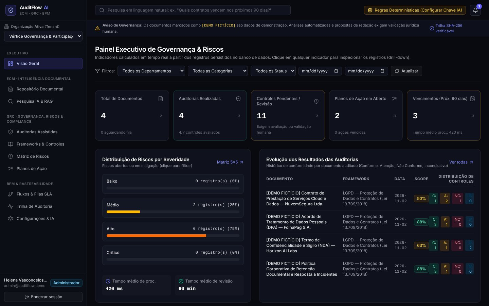
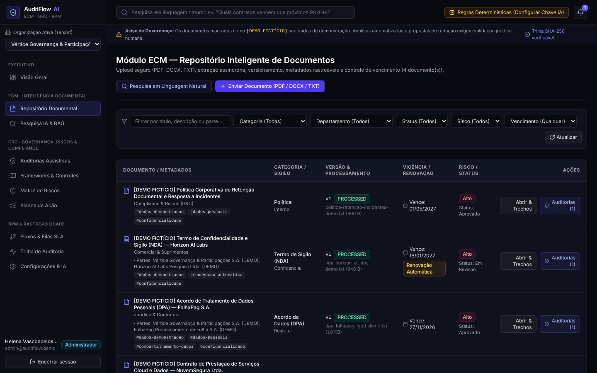
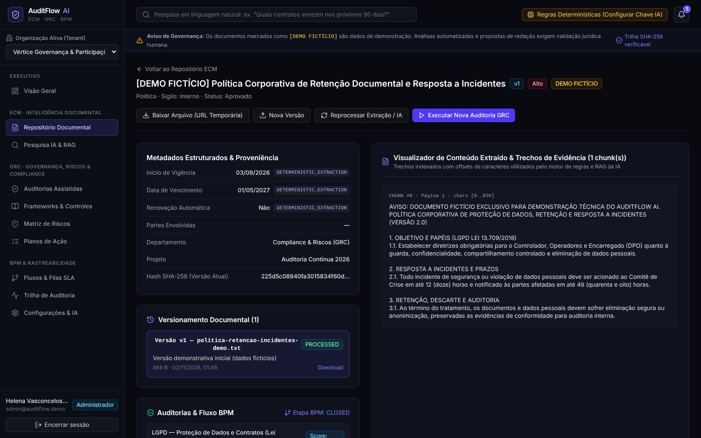

# AuditFlow AI

Plataforma corporativa de gestão de documentos, governança, riscos e compliance, com automação de fluxos de revisão e apoio de IA.

**No ar:** https://auditflow-ai-won3ers-projects.vercel.app

## Para quem é
Empresas e equipes de auditoria, jurídico e compliance que precisam controlar documentos, riscos e evidências.

## O que faz
- **Gestão de documentos**: envio, versionamento e verificação de integridade de documentos.
- **Governança, riscos e compliance**: frameworks como LGPD, matriz de risco, controles e planos de ação.
- **Auditorias e fluxos de revisão**: execução, aprovação e trilha completa de quem fez o quê.
- **Análise com IA** que separa claramente fatos extraídos do documento, regras objetivas, inferências da IA e recomendações que exigem revisão humana.
- **Papéis e permissões**: administrador, auditor, analista e leitor, com várias organizações.
- **Uso da chave de IA do próprio cliente**, com vários provedores suportados.

---

Este repositório é uma **vitrine** do projeto: mostra o que o sistema faz. O código-fonte não é público.

## Telas

Telas com os dados de demonstração fictícios que acompanham o projeto.

Desenvolvido por [@won3er](https://github.com/won3er).